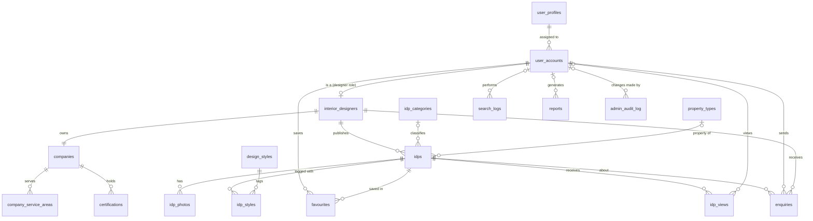

# Database schema

PostgreSQL 13+ (tested on 16). Source of truth: `db/migrations/001_initial_schema.sql` (structure) and
`002_reference_data.sql` (profiles, categories, styles, property types). Apply with `npm run migrate`.

## Entity-relationship diagram

## Entity class to table mapping

| Entity class (`src/entity`) | Table(s) |
|---|---|
| UserProfile | user_profiles |
| UserAccount | user_accounts |
| InteriorDesigner | interior_designers |
| Company | companies, company_service_areas |
| Certification | certifications |
| IDPCategory | idp_categories |
| DesignStyle | design_styles |
| PropertyType | property_types |
| IDP | idps, idp_styles |
| IDPPhoto | idp_photos |
| Favourite | favourites |
| IDPView | idp_views |
| Enquiry | enquiries |
| SearchLog | search_logs |
| Report | reports |
| PlatformStatistics | read-only aggregates over the tables above |
| AuditLog | admin_audit_log (migration 003): actor_id FK ON DELETE SET NULL, action, target_type CHECK, target_id, summary, created_at; indexed on created_at, action, actor_id |
| AccountStatistics | read-only aggregates over user_accounts, user_profiles, interior_designers for the admin overview |

`user_sessions` (session store) and `schema_migrations` (migration bookkeeping) are infrastructure tables.

## Normalisation

- Roles and permissions live once in `user_profiles`; accounts reference a profile instead of repeating a role string.
- Designer-only data (`interior_designers`, `companies`) is split from `user_accounts`, so customer rows carry no empty designer columns (1:0..1).
- Many-to-many relationships use junction tables: `idp_styles` (IDP to design style), `company_service_areas`.
- Engagement figures are never stored as counters. View, shortlist and enquiry counts are always aggregated from `idp_views`, `favourites` and `enquiries`, so they cannot drift from the facts.

## Integrity rules in the database

| Rule | Implementation |
|---|---|
| Email unique regardless of case | unique index on `LOWER(email)` |
| One company per designer | `companies.designer_id UNIQUE` |
| A customer saves an IDP at most once | `UNIQUE (customer_id, idp_id)` on favourites |
| Budget range is valid | `CHECK (budget_max >= budget_min)`, `budget_min >= 0` |
| Rejected registrations keep a reason | `CHECK (registration_status <> 'rejected' OR rejection_reason IS NOT NULL)` |
| Valid enumerations | `CHECK` on role, account status, registration status, IDP status, enquiry status, report type |
| Report period is valid | `CHECK (period_end >= period_start)` |
| No orphans when an IDP is deleted | `ON DELETE CASCADE` from idp_photos, idp_styles, favourites, idp_views, enquiries |
| Deleting a category keeps IDPs | `idps.category_id ... ON DELETE SET NULL` |
| Profiles in use cannot be deleted | `user_accounts.profile_id ... ON DELETE RESTRICT` |

## Indexes

Indexes support the frequent queries: account search (`LOWER(full_name)`, status, created_at), IDP
search filters (category, property type, status, `LOWER(location)`, budget, created_at), engagement
aggregation (`idp_views(idp_id)`, `idp_views(viewed_at)`, `favourites(idp_id)`,
`enquiries(designer_id, created_at)`), and report period scans on every `created_at`/`searched_at` column.
